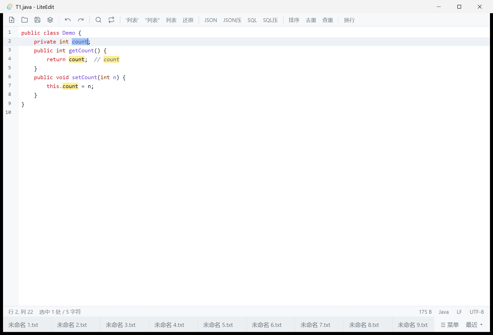

# LiteEdit

类 EditPlus 的轻量 Windows 文本编辑器。Tauri 2(Rust 壳 + 系统 WebView2)+ TypeScript,无前端框架;编辑器内核 CodeMirror 6,语法包按需懒加载。

**安装包 1.7 MB,开箱即用**,无需安装任何运行时(Win10/11 自带 WebView2)。



## 功能特性

- **多标签编辑**:脏标记、关闭/退出确认、会话恢复(含未保存草稿)、Ctrl+Tab 切换
- **语法高亮**:20+ 语言按扩展名动态加载(js/ts/json/html/css/py/c/cpp/java/rs/go/sql/php/yaml/sh/ps1/md…);超 2MB 自动降级纯文本
- **编码**:BOM / UTF-8 / GB18030 / Big5 / UTF-16LE / Latin-1 自动检测;转码保存;以编码重新打开
- **换行符**:LF / CRLF / CR 检测、状态栏切换、保存时规范化
- **查找替换**:正则 / 大小写 / 整词,面板中文化;转到行
- **文本工具**:JSON 格式化/压缩;SQL 格式化/压缩;多行合并为列表(单/双/无引号,SQL 转义)与列表还原;行排序 / 删除重复行 / 高亮重复行 —— 修数写 SQL IN 的流水线
- **书签**:Ctrl+F2 标记,F2 / Shift+F2 跳转,侧栏 ▶ 指示
- **工具栏**:常用操作 + 工具按钮,可开关
- **布局**:页签顶部/底部可切;菜单栏可隐藏(Ctrl+M);文件树侧栏(新建/重命名/回收站删除);Markdown / HTML 分栏预览
- **其他**:外部修改监测(自动重载/询问)、深浅主题(标题栏跟随)、字号缩放(Ctrl+滚轮)、光标位置历史(Ctrl+Shift+←/→)、最近文件、拖拽 / 命令行 / 文件关联打开、单实例

## 下载

从 [Releases](https://github.com/zhangyn/liteEdit/releases) 下载 NSIS 安装包(约 1.7 MB),支持 Windows 10/11。

## 快捷键

| 分类 | 快捷键 | 功能 |
|---|---|---|
| 文件 | Ctrl+N / Ctrl+O | 新建 / 打开 |
| | Ctrl+S / Ctrl+Shift+S / Ctrl+Alt+S | 保存 / 另存为 / 全部保存 |
| | Ctrl+W / Ctrl+F4 | 关闭标签 |
| 编辑 | Ctrl+Z / Ctrl+Y | 撤销 / 重做 |
| | Ctrl+D | 重复当前行 |
| | Ctrl+Shift+K | 删除当前行 |
| | Ctrl+Alt+↑ / ↓ | 上移 / 下移行 |
| | Ctrl+Enter / Ctrl+Shift+Enter | 下方 / 上方插入行 |
| | Ctrl+Shift+U / Ctrl+U | 转大写 / 转小写 |
| | Ctrl+; | 插入日期时间 |
| | Ctrl+C / Ctrl+X(空选区) | 复制 / 剪切整行 |
| 搜索 | Ctrl+F / Ctrl+H | 查找 / 替换 |
| | F3 / Shift+F3 | 下一个 / 上一个 |
| | Ctrl+G | 转到行 |
| 书签 | Ctrl+F2 / F2 / Shift+F2 | 切换 / 下一个 / 上一个 |
| 视图 | Ctrl+B | 文件树侧栏 |
| | Ctrl+Alt+W / Ctrl+Alt+V / Ctrl+Alt+T | 换行 / 预览 / 主题 |
| | Ctrl+= / Ctrl+- / Ctrl+0 / Ctrl+滚轮 | 字号 |
| | Ctrl+M | 显示/隐藏菜单栏 |
| 光标 | Ctrl+Shift+← / → | 上一个 / 下一个位置 |
| 工具 | Ctrl+1~8 | 列表合并(单/双/无)、还原、JSON 格式化/压缩、SQL 格式化/压缩 |

## 开发

```bash
npm install
npm run tauri dev      # 开发调试
npm run tauri build    # 产出 NSIS 安装包
```

要求:Node 18+、Rust 1.77+、Windows 10/11。

## 结构

```
src/            前端(vanilla TS,无框架)
  main.ts         启动、菜单/快捷键分发、拖放
  tabs.ts         标签模型、打开/保存/关闭
  editor.ts       CodeMirror 6 扩展集、行命令、书签
  langs.ts        语法包懒加载
  encoding.ts     编码探测与换行符处理
  tools.ts        JSON/SQL/列表工具
  sidebar.ts      文件树
  preview.ts      Markdown/HTML 预览
  session.ts      会话与草稿
  watch.ts        外部修改监测
  ...
src-tauri/      Rust 壳(文件命令、原生菜单、编码读写)
```

## 许可

[MIT](LICENSE)
